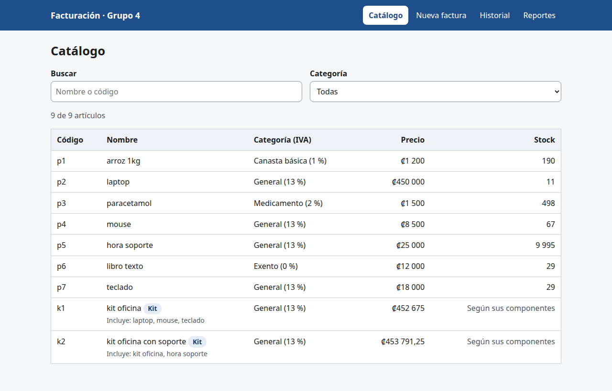
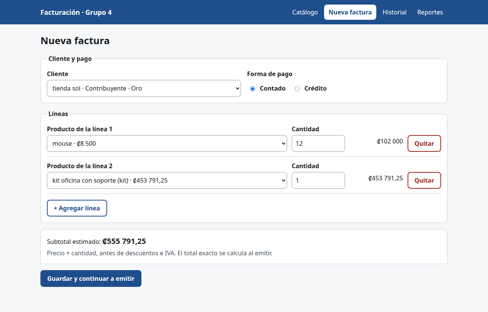
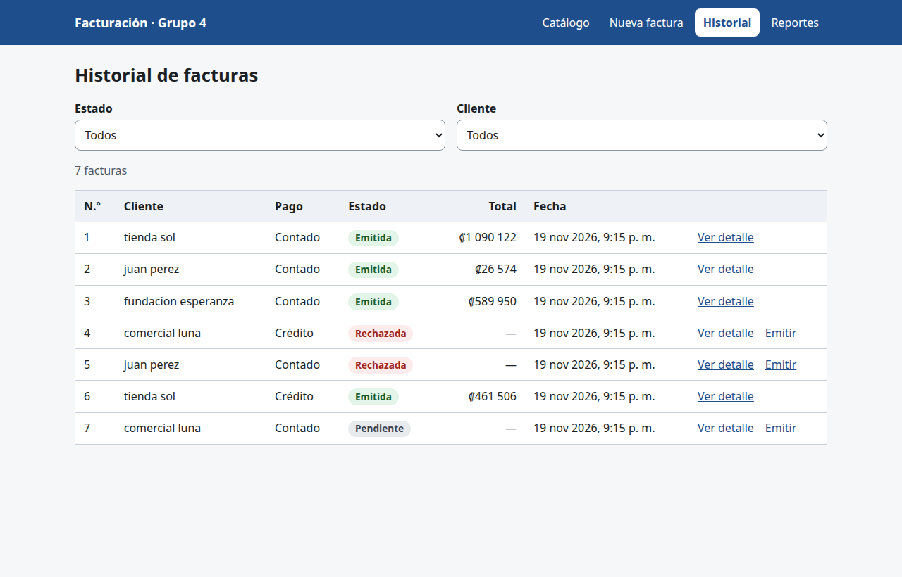
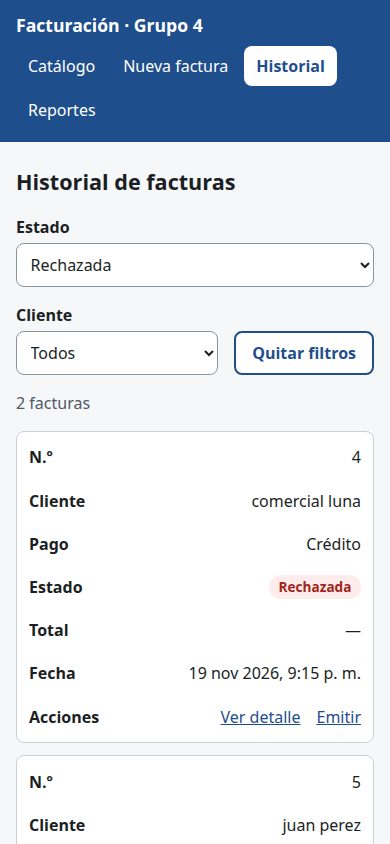

# Sistema de facturación con Prolog

[](https://github.com/GravynJimLun/facturacion-prolog-grupo4/actions/workflows/pruebas-prolog.yml)

Proyecto grupal del curso **SC-250 Paradigmas de Programación**, Universidad Fidélitas.

Es un sistema de facturación con cuatro piezas:

- **Motor de reglas (Prolog):** calcula IVA, descuentos y precios de kits, valida las facturas y explica los errores.
- **Base de datos (Neon, PostgreSQL):** guarda productos, clientes, facturas y líneas.
- **Backend (API):** recibe los pedidos del front end, lee y escribe en Neon y llama al motor Prolog.
- **Front end web:** pantallas para facturar y para ver reportes.

> Estado: en construcción.

## Estructura del repositorio

| Carpeta | Contenido |
|---|---|
| `reglas/` | Motor de reglas en Prolog (`facturacion_datos.pl` trae los datos de ejemplo) |
| `sql/` | Script de Neon: tablas y datos de ejemplo (`facturacion_neon.sql`) |
| `api/` | Backend (API) |
| `web/` | Front end |
| `docs/` | Guía del proyecto y material de apoyo |
| `BITACORA_IA.md` | Bitácora obligatoria del uso de IA |

## Cómo correrlo

### 1. Base de datos (Neon)
1. Crear un proyecto en [Neon](https://neon.tech).
2. Abrir **SQL Editor**, pegar `sql/facturacion_neon.sql` y pulsar **Run**.
3. Copiar `.env.example` como `.env` y poner ahí la cadena de conexión. **El archivo `.env` nunca se sube a GitHub.**

### 2. Motor de reglas (Prolog)
Requiere [SWI-Prolog](https://www.swi-prolog.org/download/stable).

```bash
# Consola con los datos de ejemplo
swipl reglas/consola.pl
?- totales_factura(2, Subtotal, Iva, Total).
?- errores_factura(5, Errores).

# Pruebas automáticas (plunit)
swipl -g run_tests -t halt reglas/pruebas.pl
```

`facturacion_reglas.pl` solo tiene las reglas; `facturacion_datos.pl` solo tiene los datos de ejemplo. Las pruebas corren solas en cada Pull Request con GitHub Actions. La verificación a mano de las facturas está en [docs/VERIFICACION.md](docs/VERIFICACION.md).

### 3. Backend
_Por definir: tecnología, instalación y comando para arrancarlo._

### 4. Front end
_Por definir._

## Endpoints de la API

El formato exacto de cada petición y respuesta está en [docs/CONTRATO.md](docs/CONTRATO.md).

| Método | Ruta | Descripción | Respuestas |
|---|---|---|---|
| GET | `/api/productos` | Lista los productos | 200 |
| GET | `/api/clientes` | Lista los clientes | 200 |
| GET | `/api/facturas?estado=&cliente=` | Lista las facturas (filtros opcionales) | 200 |
| GET | `/api/facturas/{id}` | Detalle de una factura con sus líneas | 200, 404 |
| POST | `/api/facturas` | Crea una factura con sus líneas | 201, 400 |
| POST | `/api/facturas/{id}/emitir` | Calcula la factura con el motor Prolog y guarda el resultado | 200, 404, 409 |
| GET | `/api/reportes` | Ventas, IVA por pagar y producto más vendido | 200 |

## Cómo trabajamos con Git

1. `git checkout main && git pull`
2. `git checkout -b nombre/tarea` (por ejemplo, `ana/reglas-iva`)
3. Hacer commits pequeños con mensajes claros.
4. `git push -u origin nombre/tarea` y abrir un **Pull Request**.
5. Otra persona revisa y aprueba el PR antes del merge. **Nadie hace push directo a `main`.**

## Integrantes

| Nombre | Usuario de GitHub | Rol principal |
|---|---|---|
| _(nombre completo)_ | [GravynJimLun](https://github.com/GravynJimLun) | Motor de reglas en Prolog, pruebas plunit, integración continua, módulo del motor para Node y pantallas de emitir, detalle y reportes |
| _(nombre completo)_ | [ArmandoR05](https://github.com/ArmandoR05) | Backend (API y Neon), colección de Postman y pantallas de catálogo, nueva factura e historial |

El reparto completo por carpeta está en [docs/CONTRATO.md](docs/CONTRATO.md) §2, y la arquitectura en [docs/ARQUITECTURA.md](docs/ARQUITECTURA.md).

## Capturas

| Catálogo | Nueva factura |
|---|---|
|  |  |

| Historial con filtros | Historial en el celular |
|---|---|
|  |  |

_Faltan las capturas de emitir, detalle y reportes (issues #21, #22 y #24)._
