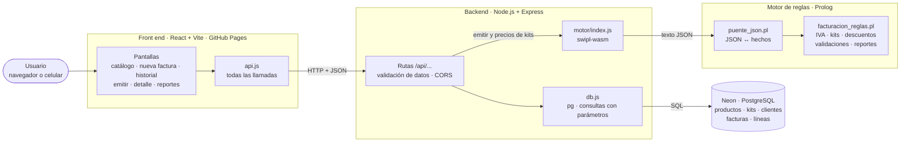
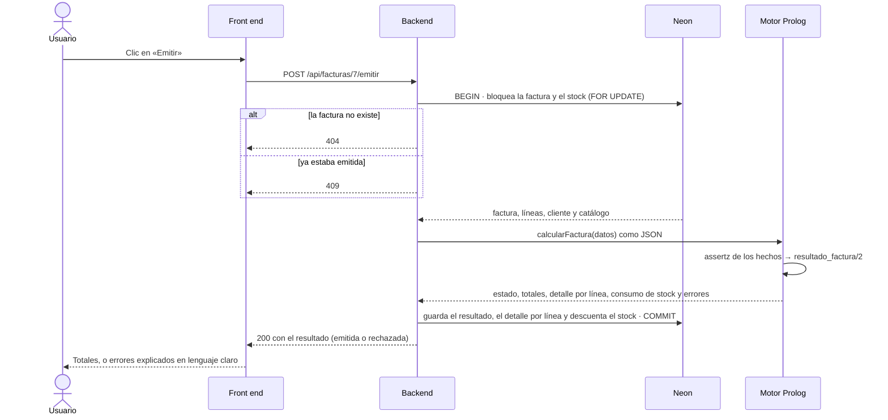

# Arquitectura del sistema

GitHub dibuja este diagrama automáticamente. Para las diapositivas se puede exportar como imagen en <https://mermaid.live>.

## Qué pasa al emitir una factura

## Decisiones principales

| Decisión | Por qué |
|---|---|
| **Opción A de la guía:** `swipl-wasm` dentro del backend | No hay que instalar SWI-Prolog en el servidor. Medido: unos 140 ms de arranque y 1 ms por factura (Entrada 3 de la bitácora) |
| Las reglas solo viven en Prolog | El backend y el front end no repiten descuentos, IVA ni validaciones. El precio de los kits también lo da el motor |
| Los datos entran a Prolog como JSON | Nunca se pegan como texto en una consulta: es el equivalente Prolog de la inyección SQL |
| Emitir en una sola transacción | O se guarda todo (estado, totales, líneas y stock) o no se guarda nada. Dos emisiones simultáneas no venden el mismo stock |
| El detalle por línea se guarda al emitir | Una factura vieja no se recalcula: el stock y los precios pudieron cambiar |
| Una factura rechazada responde 200 | La petición se procesó bien; quien dice que no es la regla del negocio |
| HashRouter (`#/`) en el front end | GitHub Pages solo sirve archivos estáticos |
